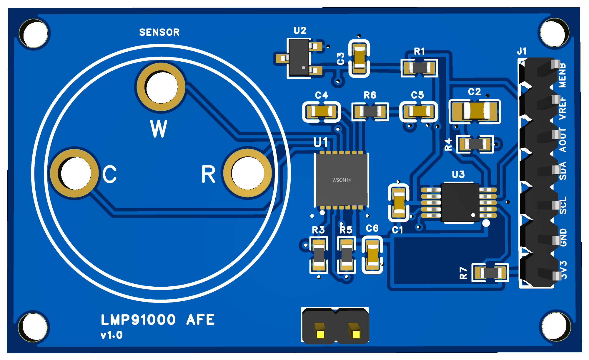
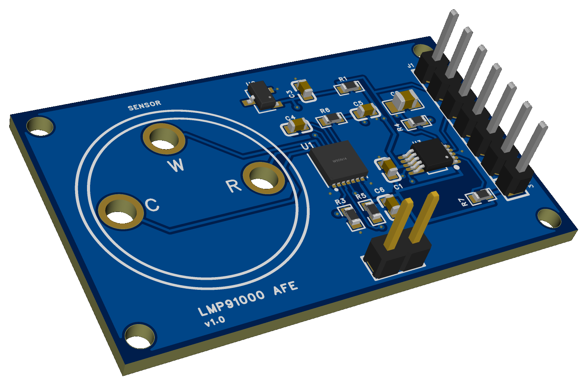
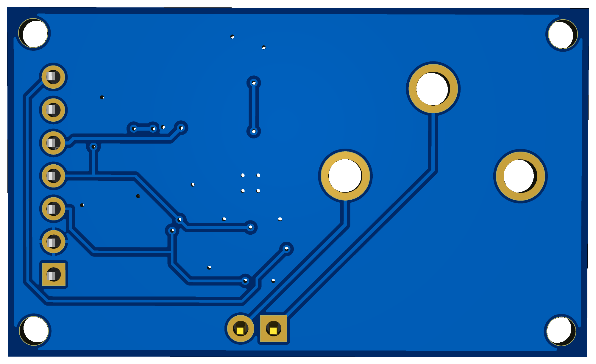
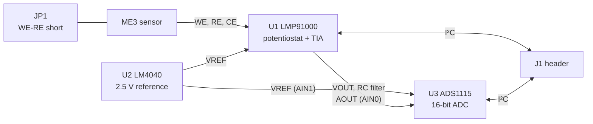

# lmp91000-afe

Analog front-end for 3-electrode electrochemical gas sensors in the Winsen ME3 form factor: TI LMP91000 potentiostat, 2.5 V reference and 16-bit ADS1115 ADC. A host configures the sensor channel and reads the gas signal over I²C.



*Render, not a photo. The sensor and its sockets are not shown.*

## Status

| Part | State |
|---|---|
| PCB | v1.0, EasyEDA Pro, DRC 0 errors. Not manufactured |
| Validation | Nothing built or measured |

## Features

- Socket footprint for Winsen ME3 sensors (Ø20 mm, 3 pins: WE, RE, CE)
- LMP91000 with programmable transimpedance gain, bias and load
- LM4040 2.5 V reference, 0.1 %, shared by the AFE and the ADC
- 16-bit differential measurement of the AFE output with the ADS1115
- One I²C bus for both chips, 10 kΩ pull-ups on board
- Jumper to short WE and RE while the sensor is stored
- 7-pin 2.54 mm header, 4 M2 mounting holes

## Specifications

| Parameter | Value |
|---|---|
| Board | 44.7 × 27.0 mm, 2 layers, 1.6 mm, GND pour on both sides |
| Supply | 3.3 V |
| Mounting holes | 4 × Ø2.2 mm non-plated (M2), 40.7 × 23.0 mm, 2.0 mm from the edges |
| Sensor pads | Ø3.7 mm, Ø2.6 mm hole, 13.5 mm pin circle |





## Architecture



The ADC measures `AOUT - VREF` differentially, so the reading is referenced to the same 2.5 V source that sets the LMP91000 operating point. `AOUT` and `VREF` are also available on J1 for an external ADC.

## Connector J1

| Pin | Signal | Description |
|---|---|---|
| 1 | `3V3` | 3.3 V supply input |
| 2 | `GND` | Ground |
| 3 | `SCL` | I²C clock, 10 kΩ pull-up on board |
| 4 | `SDA` | I²C data, 10 kΩ pull-up on board |
| 5 | `AOUT` | Filtered LMP91000 output |
| 6 | `VREF` | 2.5 V reference output |
| 7 | `MENB` | LMP91000 enable, active low, 10 kΩ pull-down on board |

Pin 1 is the square pad. The board is designed for 3.3 V: R1 is sized for this rail.

The ADS1115 `ALERT/RDY` pin is pulled up but not routed to J1, so conversion status has to be polled over I²C.

## I²C devices

| Device | Address | Notes |
|---|---|---|
| LMP91000 | `0x48` | Fixed address. Responds only while `MENB` is low, which is the default state. |
| ADS1115 | `0x49` | `ADDR` tied to VDD |

## Firmware notes

- Clear the LMP91000 `LOCK` bit before configuring it: `TIACN` and `REFCN` can only be written while it is `0`.
- Set the LMP91000 reference source to external (`REF_SOURCE = 1` in `REFCN`), otherwise it uses VDD instead of the 2.5 V reference.
- Select RTIA, RLoad, internal zero and bias to match the sensor in use. These depend on the sensor type, so check its datasheet.
- Read the ADS1115 in differential mode, `AIN0 - AIN1`. `AIN2` and `AIN3` are tied to ground.
- C4 (100 nF between `C1` and `C2`) sets the TIA low-pass corner, so the corner frequency changes with the selected RTIA. Allow for this when choosing a sample rate.
- R6 and C5 (1 kΩ, 100 nF) form a filter at about 1.6 kHz on the output.

## Sensor handling

From the Winsen ME3 manual:

- **Do not solder the sensor.** Fit it into sockets.
- Keep WE and RE shorted during storage. Fit a jumper on JP1, and remove it before measuring.
- Preheat for more than 48 hours before use.

The sensor pin layout is printed on the silkscreen. The WE and RE traces also run to JP1, so the board should be cleaned of flux after soldering to keep leakage on these nodes low.

## Ordering

Upload [`release/v1.0/gerber-v1.0.zip`](release/v1.0) and send:

```text
5PCS, 2 LAYERS, FR4, 1.6MM, 1OZ, Purple Soldermask, White Legend, Lead-free HASL, order number will be added.
```

| Item | Value |
|---|---|
| Surface finish | Lead-free HASL to keep the cost down. U1 (WSON-14, exposed pad) and U3 (MSOP-10) have 0.5 mm pitch: solder with a bottom preheater and hot air, check for bridges. ENIG is an option at extra cost |
| Smallest track | 0.2 mm |
| Plated holes | 0.3, 1.1, 1.2 and 2.6 mm |
| Non-plated holes | 4 × 2.2 mm |
| Panelization | None, delivered as single boards |
| Solder mask between U1 pads | About 0.017 mm, too thin to make. Removing it is acceptable. |
| Solder mask between U3 pads | 0.12 mm. Removing it is acceptable. |
| Vias | Tented, except the four in the U1 exposed pad: open on top, tented on the bottom, on purpose |
| Stencil | Needed for hand assembly: U1 cannot be soldered with an iron. The paste layer is in the Gerber archive |

## Bill of materials

See [`release/v1.0/BOM.md`](release/v1.0/BOM.md).

## Repository

| Path | Content |
|---|---|
| [`release/v1.0`](release/v1.0) | Ordering package: Gerber, BOM, placement |
| [`docs/images`](docs/images) | Renders |

The EasyEDA Pro project `LMP91000 AFE` is not stored here.

## Sources

- [LMP91000 datasheet](https://www.ti.com/lit/ds/symlink/lmp91000.pdf)
- [ADS1115 datasheet](https://www.ti.com/lit/ds/symlink/ads1115.pdf)
- [LM4040-N datasheet](https://www.ti.com/lit/ds/symlink/lm4040-n.pdf)
- [Winsen ME3-NO2 manual](https://www.winsen-sensor.com/d/files/manual/me3-no2.pdf)
