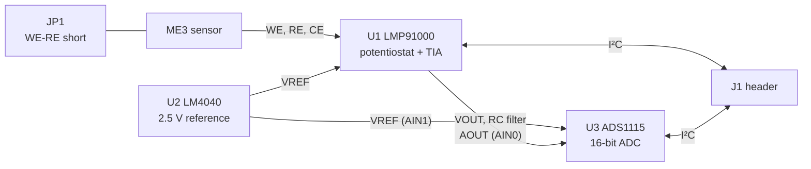

# lmp91000-afe

Analog front-end board for 3-electrode electrochemical gas sensors in the Winsen ME3 form factor. It combines a TI LMP91000 potentiostat, a 2.5 V precision reference and a 16-bit ADS1115 ADC, so a host can configure the sensor channel and read gas concentration over I²C.

> **Status:** v1.0. The layout passes EasyEDA DRC, but the board has not yet been fabricated or tested on hardware.

## Features

- Socket footprint for Winsen ME3 series sensors (Ø20 mm, 3 pins: WE, RE, CE)
- LMP91000 with programmable transimpedance gain, bias and load
- External 2.5 V reference (LM4040, 0.1 %) for the AFE and the ADC
- 16-bit differential measurement of the AFE output with the ADS1115
- Single I²C bus for both chips, with on-board 10 kΩ pull-ups
- Jumper to short WE and RE while the sensor is stored
- 7-pin 2.54 mm header, 4 M2 mounting holes

## Architecture

The ADC measures `AOUT - VREF` differentially, so the reading is referenced to the same 2.5 V source that sets the LMP91000 operating point. `AOUT` and `VREF` are also available on J1 for an external ADC.

## Connector J1

| Pin | Signal | Description |
| --- | ------ | ----------- |
| 1 | `3V3` | 3.3 V supply input |
| 2 | `GND` | Ground |
| 3 | `SCL` | I²C clock, 10 kΩ pull-up on board |
| 4 | `SDA` | I²C data, 10 kΩ pull-up on board |
| 5 | `AOUT` | Filtered LMP91000 output |
| 6 | `VREF` | 2.5 V reference output |
| 7 | `MENB` | LMP91000 enable, active low, 10 kΩ pull-down on board |

Pin 1 is the square pad. The board is designed for 3.3 V: R1 is sized for this rail.

The ADS1115 `ALERT/RDY` pin is pulled up but not routed to J1, so conversion status has to be polled over I²C.

## I²C devices

| Device | Address | Notes |
| ------ | ------- | ----- |
| LMP91000 | `0x48` | Fixed address. Responds only while `MENB` is low, which is the default state. |
| ADS1115 | `0x49` | `ADDR` tied to VDD |

## Firmware notes

- Clear the LMP91000 `LOCK` bit before configuring it: `TIACN` and `REFCN` can only be written while it is `0`.
- Set the LMP91000 reference source to external (`REF_SOURCE = 1` in `REFCN`), otherwise it uses VDD instead of the 2.5 V reference.
- Select RTIA, RLoad, internal zero and bias to match the sensor in use. These depend on the sensor type, so check its datasheet.
- Read the ADS1115 in differential mode, `AIN0 - AIN1`. `AIN2` and `AIN3` are tied to ground.
- C4 (100 nF between `C1` and `C2`) sets the TIA low-pass corner, so the corner frequency changes with the selected RTIA. Allow for this when choosing a sample rate.
- R6 and C5 (1 kΩ, 100 nF) form a filter at about 1.6 kHz on the output.

## Sensor handling

From the Winsen ME3 manual:

- **Do not solder the sensor.** Fit it into sockets.
- Keep WE and RE shorted during storage. Fit a jumper on JP1, and remove it before measuring.
- Preheat for more than 48 hours before use.

The sensor pin layout is printed on the silkscreen. The WE and RE traces also run to JP1, so the board should be cleaned of flux after soldering to keep leakage on these nodes low.

## PCB

| Parameter | Value |
| --------- | ----- |
| Size | 44.7 × 27.0 mm |
| Layers | 2, with GND pour on both sides |
| Mounting holes | 4 × Ø2.2 mm non-plated (M2), 2.0 mm from the edges |
| Hole spacing | 40.7 × 23.0 mm |
| Smallest via | 0.3 mm drill, 0.6 mm pad |
| Sensor pads | Ø3.7 mm, Ø2.6 mm hole, on a 13.5 mm pin circle |

## Bill of materials

| Designator | Qty | Value / part | Footprint | LCSC |
| ---------- | --- | ------------ | --------- | ---- |
| U1 | 1 | LMP91000SD/NOPB | WSON-14 | C84366 |
| U2 | 1 | LM4040AIM3-2.5/NOPB | SOT-23 | C139302 |
| U3 | 1 | ADS1115IDGSR | MSOP-10 | C37593 |
| C1, C3, C4, C5, C6 | 5 | 100 nF | 0603 | C14663 |
| C2 | 1 | 10 µF | 0805 | C15850 |
| R1 | 1 | 1.5 kΩ | 0603 | C22843 |
| R3, R4, R5, R7 | 4 | 10 kΩ | 0603 | C25804 |
| R6 | 1 | 1 kΩ | 0603 | C21190 |
| J1 | 1 | PZ254V-11-07P | 1×7 2.54 mm | C492406 |
| JP1 | 1 | PZ254V-11-02P | 1×2 2.54 mm | C492401 |
| SENSOR | 1 | Winsen ME3 series | Custom | — |

Designator R2 is not used. Sensor sockets are not listed in the BOM: choose them to fit the Ø2.6 mm holes.

## Repository layout

| Path | Contents |
| ---- | -------- |
| `production/LMP91000_AFE_v1.0_gerber.zip` | Gerber and drill files for a single board |
| `production/LMP91000_AFE_v1.0_BOM.csv` | Bill of materials |
| `production/LMP91000_AFE_v1.0_CPL.csv` | Pick-and-place file |

The fabrication files were generated with EasyEDA Pro. The EasyEDA source project is not stored in this repository.

## References

- [LMP91000 datasheet](https://www.ti.com/lit/ds/symlink/lmp91000.pdf)
- [ADS1115 datasheet](https://www.ti.com/lit/ds/symlink/ads1115.pdf)
- [LM4040-N datasheet](https://www.ti.com/lit/ds/symlink/lm4040-n.pdf)
- [Winsen ME3-NO2 manual](https://www.winsen-sensor.com/d/files/manual/me3-no2.pdf)
